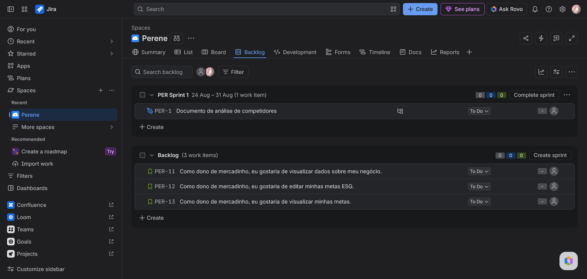
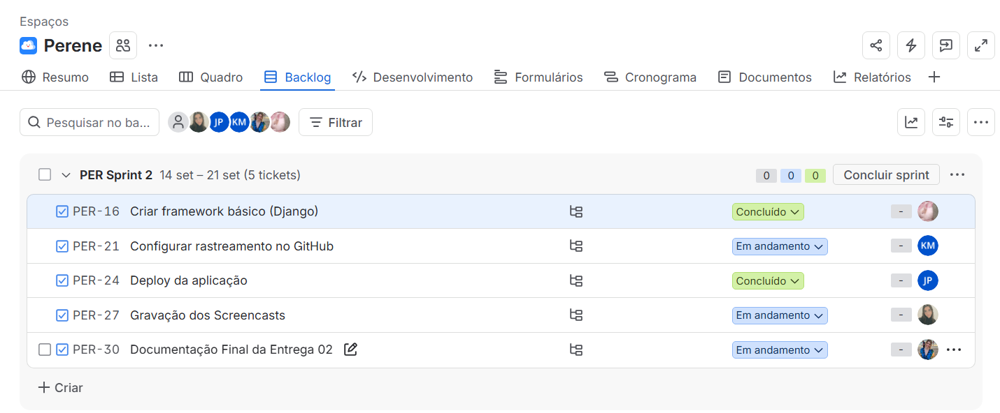
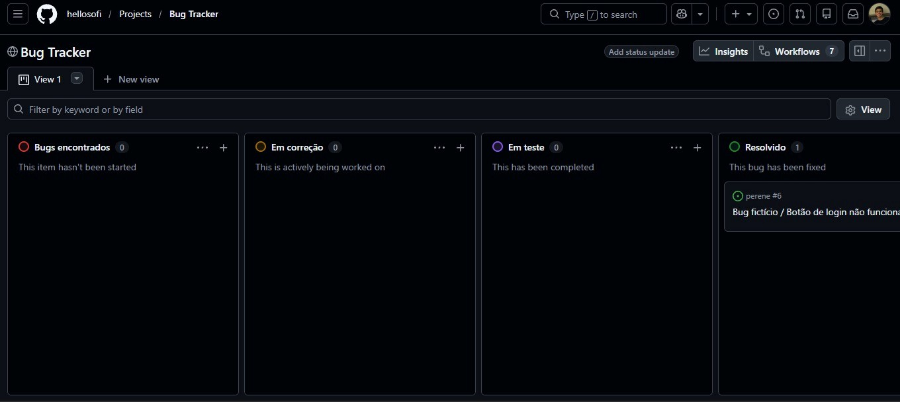
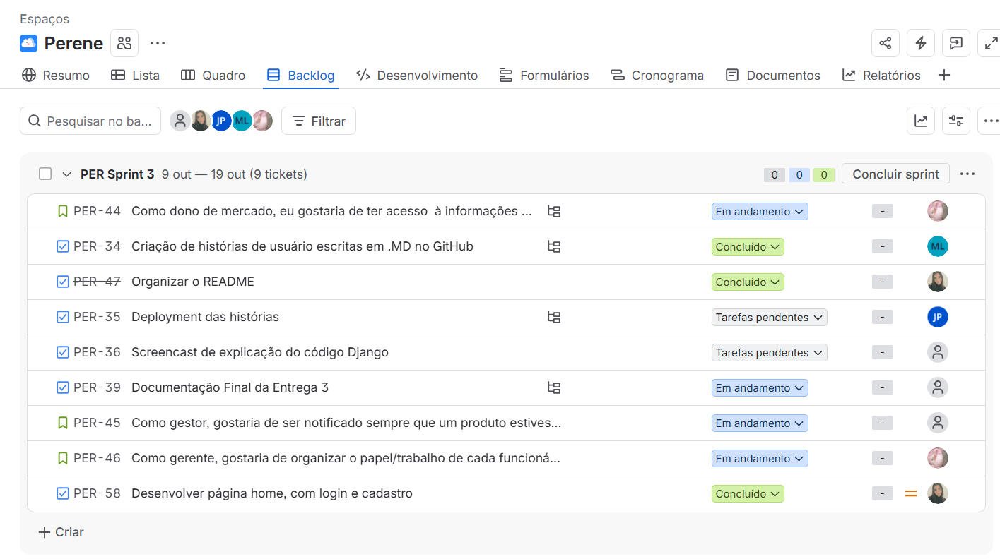
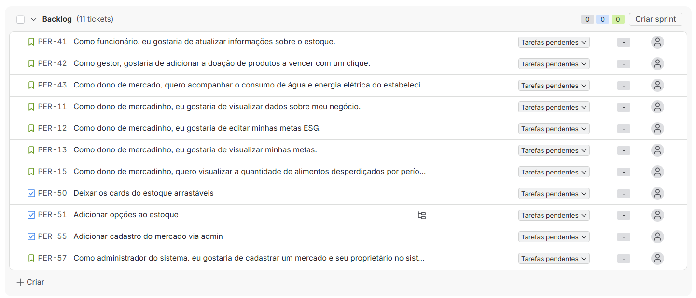

# $${\color{darkseagreen}Perene}$$
<h3> Soluções ESG para pequenas e médias empresas no setor de varejo alimentar </h3>
<h4><em>Fundamentos de Desenvolvimento de Software</em></h4>

## Sobre o Projeto Perene
O projeto Perene surge da necessidade dos mercados de pequeno e médio porte (no setor varejista supermercadista), evoluírem para não ficar para trás quando se trata das medidas cada vez mais presentes de ESG em suas funções.

## Nossa solução
Propomos um site e aplicativo que possibilita de maneira simples donos ou gerentes de mercados de médio e pequeno porte nas medidas ambientais, sociais e de governança. dentre nossas várias funcionalidades, as que mais se destacam são: consultoria automática, cardápio de empresas alinhadas a ESG.

## $${\color{darkseagreen}Acesso \space ao \space Deploy \space :}$$
A url do nosso projeto já está disponível, acesse o link abaixo e veja nossa plataforma desenvolvida para a implementação de ESG no ramo de varejo alimentar! 
<h4 align="center" target="_blank">https://perene.onrender.com</h4>

---
## ୭  🧷  Como Rodar o Projeto Localmente

### Pré-requisitos

- Python
- Git

### 1. Clonar o repositório

```bash
git clone https://github.com/hellosofi/perene.git
cd perene
```

### 2. Criar e ativar o ambiente virtual

No Windows (PowerShell):

```powershell
py -m venv .venv
.\.venv\Scripts\Activate.ps1
```
Mac/Linux (Terminal):

```
python3 -m venv .venv
source .venv/bin/activate
```

### 3. Instalar as dependências

```bash
pip install -r requirements.txt
```

### 4. Configurar as variáveis de ambiente

Crie um arquivo `.env` na raiz do projeto, na mesma pasta do `manage.py`.

Gere uma chave secreta com o comando:

```bash
py -c "from django.core.management.utils import get_random_secret_key; print(get_random_secret_key())"
```

No arquivo `.env`, adicione:

```env
SECRET_KEY=cole-sua-chave-gerada-aqui
ENVIRONMENT=development
```

Substitua `cole-sua-chave-gerada-aqui` pela chave gerada no comando anterior.

Para liberar o cadastro de gestor pela página, defina também um código de acesso (quem não souber o código não consegue criar conta de gestor):

```env
GESTOR_CODIGO_CONVITE=escolha-um-codigo-aqui
```

No deploy (Render), adicione essa mesma variável em *Environment*.

### 5. Executar as migrações

```bash
python manage.py migrate
```

### 6. Verificar o projeto

```bash
python manage.py check
```

### 7. Iniciar o servidor

```bash
python manage.py runserver
```

A aplicação ficará disponível em:

http://127.0.0.1:8000/

---
## $${\color{darkseagreen}Tecnologias \space usadas \space :}$$

<div align="center">


</div>

| Tecnologia | Para que usamos |
|---|---|
| Python e Django | Back-end, rotas, autenticação (login de funcionário e gestor) e painel admin |
| HTML e CSS | Páginas e estilo do site |
| SQLite | Banco de dados no desenvolvimento local |
| PostgreSQL | Banco de dados no site publicado |
| Gunicorn e WhiteNoise | Servidor da aplicação e entrega dos arquivos estáticos (CSS, imagens) |
| python-dotenv e dj-database-url | Leitura das variáveis de ambiente (`.env`) e da conexão com o banco |
| Render | Hospedagem e deploy do site |
| Git e GitHub | Controle de versão e repositório |
| Jira | Organização do backlog e das sprints |
| Figma | Protótipo das telas |
| Claude AI| Assistente de IA usado para revisão de código |

---
## $${\color{darkseagreen}Entregas}$$

### ⭐┆ Entrega 01

<h4 align="center">𖥸</h4>

<div align="center"><a href="https://grupo-perene.atlassian.net"></a>

<a href="https://github.com/hellosofi/perene/blob/main/entregas/entrega-01/documento-analise.md"></a>

</div>




<br/>

### ⭐┆ Entrega 02



<br/>



<br/>

Veja o projeto funcionando: [Acesse o vídeo no Youtube](https://youtu.be/EpsZ5v47rjs)
<br/>
Explicação do código inicial (W.I.P): [Youtube](https://youtu.be/7_4VonwUPlg?si=UQOuGa8QSrvDRjkZ)

### ⭐┆ Entrega 03

<div align="center">

<a href="https://github.com/hellosofi/perene/blob/main/entregas/entrega-03/historias.md"></a>

</div>



<br/>



<br/>


<br/>

Explicação do código Django: [Youtube](https://www.youtube.com/watch?v=sAK3rgWsdeo)
Demonstração das Histórias de Usuário: [Youtube](https://www.youtube.com/watch?v=W3mO9d5cqSs)

---

### $${\color{darkseagreen}Nossa \space equipe \space :}$$

<div align="center">

<!-- <table style="">
  <tr>
    <td align="center"><a href="https://github.com/joaogpedrosa">
      
      </a>
      <br/>
      João Gustavo
    </td>
    <td align="center"><a href="https://github.com/heykauac">
      
      </a>
      <br/>
      Kauã Cardoso
    </td>
    <td align="center">
      <a href="https://github.com/lunnaaguiar">
        
        </a>
        <br/>
        Lunna de A.
      </td> 
    <td align="center">
      <a href="https://github.com/matheuspinheirol">
        
        </a>
        <br/>
        Matheus P.
      </td>
    <td align="center"><a href="https://github.com/algaerithm">
      
      </a>
      <br/>
      Nara Melo
    </td>
    <td align="center"><a href="https://github.com/hellosofi">
      
      </a>
      <br/>
      Sofia Carolina
    </td>
  </tr>
</table> -->


| Nome Completo | E-mail da School |
| :---: | :---: |
| João Gustavo Vieira Fernandes Pedrosa | jgvfp@cesar.school |
| Kauã Cardoso de Melo | kcm2@cesar.school |
| Lunna de Aguiar Mendonça Morelato Moreno | lammm@cesar.school |
| Matheus Pinheiro Laurentino | mpl2@cesar.school |
| Nara de Melo Santos | nms2@cesar.school |
| Sofia Carolina Santos Bezerra | scsb@cesar.school |

</div>
