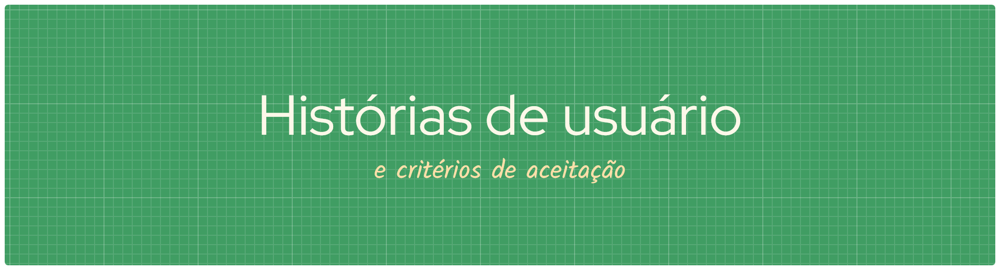

<!-- # Histórias de usuário -->

<h1 align="center">História 1: Como funcionário, eu gostaria de atualizar informações sobre o estoque.</h1>

### Critérios de aceitação:

- [x] Os produtos devem estar separados por categorias;

- [x] O funcionário deve ser notificado caso o item pesquisado não conste no sistema;

- [x] Será possível encontrar produtos pelo código de barras;

- [x] Os funcionários podem escrever observações para diferentes lotes.

### Cenários de Validação (BDD)
_Cenário 1: Pesquisar produto pelo código de barras_

```gherkin
  Dado que existe um produto cadastrado no estoque com código de barras.

  Quando o funcionário pesquisar pelo código de barras do produto.

  Então o sistema deve exibir as informações do produto e sua respectiva categoria.
```

_Cenário 2: Pesquisar produto inexistente_

```gherkin
Dado que o funcionário acessou a área de estoque.

Quando pesquisar um produto que não está cadastrado no sistema.

Então o sistema deve informar que o produto não foi encontrado.
```

_Cenário 3: Registrar observação em um lote_

```gherkin
Dado que existe um produto com lote cadastrado no sistema.

Quando o funcionário escrever e salvar uma observação para esse lote.

Então o sistema deve registrar a observação no lote correspondente.
```
---

<h1 align="center">História 2: Como gestor, quero acionar a doação de produtos a vencer com um clique.</h1>

### Critérios de aceitação:

- [x] A página deverá exibir uma lista de ONG’s;

- [x] O usuário poderá abrir e confirmar o agendamento de recolha dos produtos;

- [x] O usuário receberá um cartão automático com métricas da doação (estimativa de refeições fornecidas).

### Cenários de Validação (BDD)
_Cenário 1: Consultar ONGs disponíveis e agendar recolha_

```gherkin
Dado que existem ONGs cadastradas e produtos disponíveis para doação.

Quando o gestor selecionar uma ONG e confirmar o agendamento da recolha.

Então o sistema deve registrar o agendamento e apresentar uma confirmação ao gestor.
```

_Cenário 2: Visualizar métricas da doação_

```gherkin
Dado que uma doação foi registrada no sistema.

Quando o sistema gerar as métricas da doação.

Então o sistema deve exibir um cartão com as informações da doação e a estimativa de refeições fornecidas.
```
---
<h1 align="center">História 3: Como dono de mercado, quero acompanhar o consumo de água e energia elétrica do estabelecimento.</h1>

### Critérios de aceitação:

- [x] O usuário visualizará um painel mostrando o histórico de consumo mensal de água e energia elétrica;

- [x] O usuário receberá alertas automáticos caso o sistema identifique picos anormais de consumo;

- [x] A página exibirá registros por período;

- [x] A página informará quando não houver dados registrados para o período selecionado.


### Cenários de Validação (BDD)
_Cenário 1: Consultar histórico de consumo_

```gherkin
Dado que existem registros de consumo de água e energia elétrica.

Quando o dono do mercado selecionar um período para consulta.

Então o sistema deve exibir o histórico de consumo dos dois recursos para o período selecionado.
```

_Cenário 2: Identificar pico anormal de consumo_

```gherkin
Dado que existem registros de consumo e um limite de alerta definido.

Quando o sistema identificar um pico de consumo acima do limite estabelecido.

Então o sistema deve gerar um alerta informando o consumo anormal.
```

_Cenário 3: Consultar período sem registros_

```gherkin
Dado que o dono do mercado acessou o painel de consumo.

Quando selecionar um período sem dados registrados.

Então o sistema deve informar que não existem dados disponíveis para o período selecionado.
```
---

<h1 align="center">História 4: Como dono de mercado, eu gostaria de ter acesso à informações sobre o estoque.</h1>

### Critérios de aceitação:

- [x] O usuário poderá pesquisar itens específicos informando nome ou código;

- [x] O usuário poderá ver etiquetas de cores no painel;

- [x] O usuário poderá visualizar uma listagem completa dos produtos e suas respectivas quantidades;

- [x] A página informará quando nenhum produto corresponder à pesquisa.

### Cenários de Validação (BDD)
_Cenário 1: Consultar produtos e suas classificações_

```gherkin
Dado que existem produtos cadastrados com quantidades e classificações definidas.

Quando o usuário acessar o painel de estoque.

Então o sistema deve exibir a listagem de produtos, suas respectivas quantidades e as etiquetas de cores correspondentes.
```

_Cenário 2: Pesquisar produto pelo nome ou código_

```gherkin
Dado que existem produtos cadastrados no estoque.

Quando o usuário pesquisar um produto pelo nome ou código correspondente.

Então o sistema deve exibir os produtos encontrados.
```

_Cenário 3: Pesquisar produto inexistente_

```gherkin
Dado que o usuário acessou o painel de estoque.

Quando pesquisar um nome ou código sem correspondência no sistema.

Então o sistema deve informar que nenhum produto foi encontrado.
```
---

<h1 align="center">História 5: Como gestor, gostaria de ser notificado sempre que um produto estivesse perto da data de vencimento.</h1>

## Critérios de aceitação:

- [x] A página notificará o gestor sobre produtos próximos ao vencimento;

- [x] Notificação aparece na página principal do sistema.

### Cenários de Validação (BDD)
_Cenário 1: Notificar sobre produto próximo do vencimento_

```gherkin
Dado que existe um produto cadastrado dentro do prazo de alerta de vencimento.

Quando o sistema verificar as datas de vencimento dos produtos.

Então o sistema deve gerar uma notificação para o gestor.
```

_Cenário 2: Exibir notificação na página principal_

```gherkin
Dado que o sistema identificou um produto próximo do vencimento e gerou uma notificação.

Quando o gestor acessar a página principal.

Então o sistema deve exibir a notificação com informações sobre o produto.
```
---

<h1 align="center">História 6: Como gerente, gostaria de organizar o papel/trabalho de cada funcionário.</h1>

### Critérios de aceitação:

- [x] O usuário poderá cadastrar as funções dos funcionários;

- [x] O usuário poderá atribuir tarefas a cada funcionário;

- [x] A página exibirá as tarefas atribuídas a seus respectivos responsáveis;

- [x] A página impedirá a atribuição de tarefas a funcionários não cadastrados.

### Cenários de Validação (BDD)
_Cenário 1: Cadastrar função e atribuir tarefa_

```gherkin
Dado que existe um funcionário cadastrado no sistema.

Quando o gerente cadastrar uma função e atribuir uma tarefa a esse funcionário.

Então o sistema deve salvar a função, registrar a tarefa e exibir o responsável correspondente.
```

_Cenário 2: Impedir atribuição a funcionário não cadastrado_

```gherkin
Dado que o funcionário informado não está cadastrado no sistema.

Quando o gerente tentar atribuir uma tarefa a esse funcionário.

Então o sistema deve impedir a atribuição e informar que o funcionário não foi encontrado.
```
